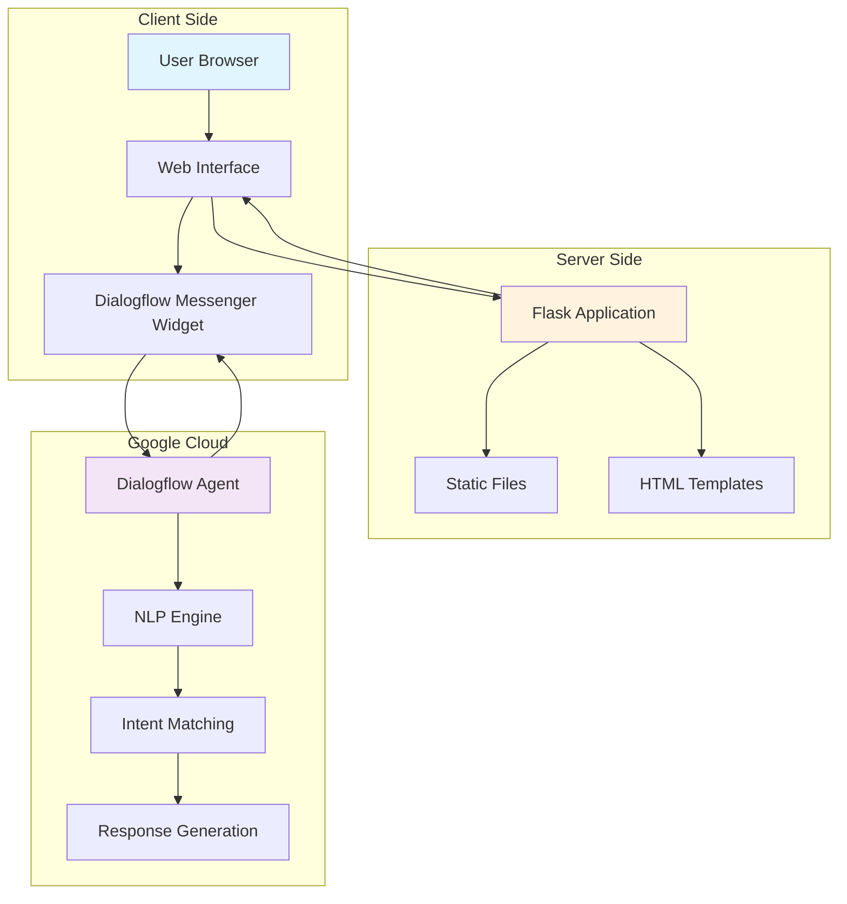
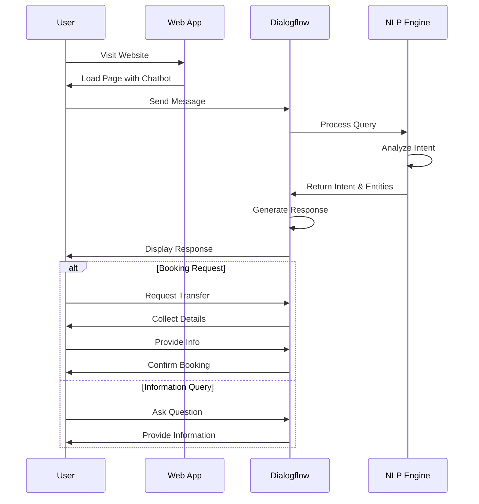
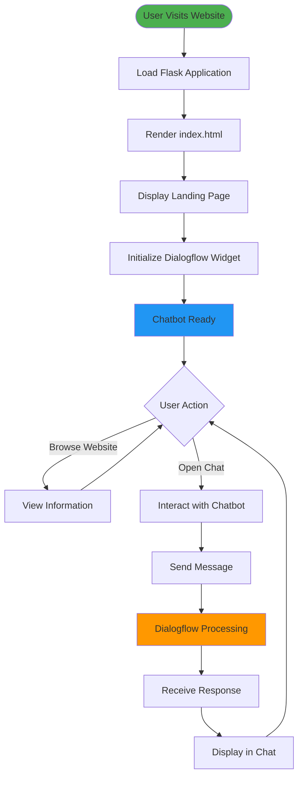
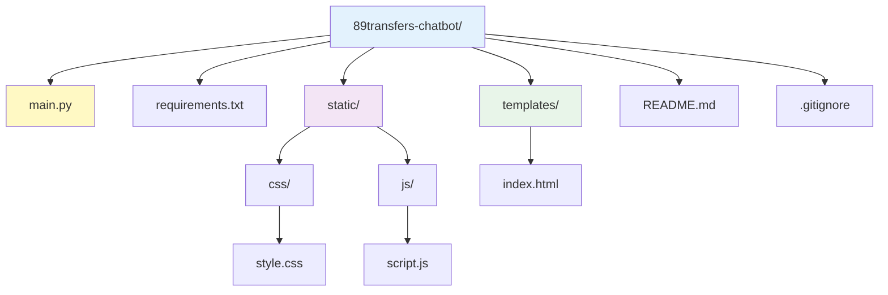
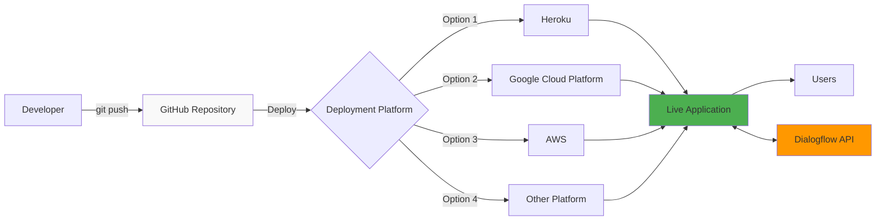
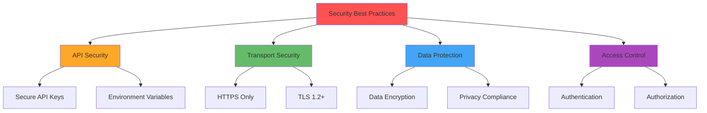
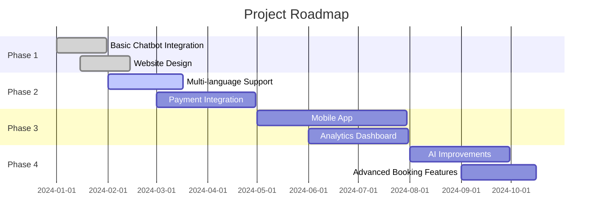
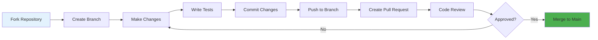

# 🚗 89transfers Chatbot

<div align="center">

A conversational AI-powered chatbot solution for a Mallorca airport transfer service. This repository contains a web application with an integrated Dialogflow chatbot to help customers book transfers and get information about services.


</div>

## 📖 Overview

The 89transfers chatbot is built using Google's Dialogflow platform and is integrated into a Flask web application. The chatbot provides a conversational interface for customers to:

- Inquire about transfer services
- Get information about pricing
- Learn about the booking process
- Ask questions about transfers in Mallorca
- Receive instant assistance 24/7

## 🏗️ System Architecture



## 🔄 Chatbot Conversation Flow



## ✨ Features

| Feature | Description | Status |
|---------|-------------|--------|
| 🤖 **Conversational AI** | Powered by Google Dialogflow with natural language understanding | ✅ Active |
| 📱 **Responsive Design** | Works seamlessly on desktop, tablet, and mobile devices | ✅ Active |
| 💳 **No-Advance-Payment** | Pay only upon arrival in Mallorca (cash or card accepted) | ✅ Active |
| ⏰ **24/7 Availability** | Chatbot available round the clock for customer queries | ✅ Active |
| 🚀 **Easy Integration** | Simple to deploy and maintain with minimal setup | ✅ Active |
| 🌍 **Multi-language Support** | Configurable language support through Dialogflow | 🔧 Configurable |
| 🎨 **Customizable UI** | Fully customizable chat widget appearance | 🔧 Configurable |

## 🛠️ Technologies Used

### Technology Stack

| Layer | Technology | Version | Purpose |
|-------|-----------|---------|---------|
| **Backend** | Flask | 3.0.3 | Web application framework |
| **Backend** | Python | 3.7+ | Programming language |
| **Server** | Gunicorn | 23.0.0 | WSGI HTTP server |
| **Frontend** | HTML5 | - | Structure and content |
| **Frontend** | CSS3 | - | Styling and layout |
| **Frontend** | JavaScript | - | Client-side interactions |
| **AI Platform** | Google Dialogflow | - | Natural language processing |
| **Deployment** | Cloud Platform | - | Heroku, GCP, AWS, etc. |

### Dependencies

| Package | Version | Description |
|---------|---------|-------------|
| Flask | 3.0.3 | Micro web framework |
| gunicorn | 23.0.0 | Production WSGI server |
| Werkzeug | 3.0.3 | WSGI utility library |

## 🚀 Getting Started

### Prerequisites

- Python 3.7+
- Google Cloud account with Dialogflow API enabled
- Basic knowledge of Flask and web development

### Installation

1. Clone the repository:
   ```bash
   git clone https://github.com/Yash-Kavaiya/89transfers-chatbot.git
   cd 89transfers-chatbot
   ```

2. Create a virtual environment:
   ```bash
   python -m venv venv
   source venv/bin/activate  # On Windows, use: venv\Scripts\activate
   ```

3. Install dependencies:
   ```bash
   pip install -r requirements.txt
   ```

4. Run the application:
   ```bash
   python main.py
   ```

5. Open your browser and navigate to:
   ```
   http://localhost:8080
   ```

### Application Flow



## 📡 API Endpoints

| Method | Endpoint | Description | Response |
|--------|----------|-------------|----------|
| `GET` | `/` | Main landing page | HTML page with chatbot |
| `GET` | `/static/css/style.css` | CSS stylesheet | CSS file |
| `GET` | `/static/js/script.js` | JavaScript file | JS file |

## 🔧 Configuration

### Dialogflow Setup

The chatbot uses Dialogflow Messenger which is integrated directly in the HTML. You'll need to update the following parameters in the `templates/index.html` file:

```html
<df-messenger
  project-id="YOUR_PROJECT_ID"
  agent-id="YOUR_AGENT_ID"
  language-code="en"
  max-query-length="-1">
  <df-messenger-chat-bubble
    chat-title="89transfers">
  </df-messenger-chat-bubble>
</df-messenger>
```

### Configuration Parameters

| Parameter | Type | Required | Description | Example |
|-----------|------|----------|-------------|---------|
| `project-id` | String | ✅ Yes | Your Google Cloud project ID | `my-project-123` |
| `agent-id` | String | ✅ Yes | Your Dialogflow agent ID | `a1b2c3d4-e5f6-7890` |
| `language-code` | String | ✅ Yes | Language code for the chatbot | `en`, `es`, `de` |
| `max-query-length` | Number | ❌ No | Maximum query length (-1 = unlimited) | `-1` |
| `chat-title` | String | ❌ No | Title displayed in chat bubble | `89transfers` |

### Environment Variables

| Variable | Description | Default | Required |
|----------|-------------|---------|----------|
| `PORT` | Port number for Flask app | `8080` | ❌ No |
| `FLASK_ENV` | Environment (development/production) | `production` | ❌ No |

## 📚 Project Structure



### File Structure Table

| Path | Type | Description |
|------|------|-------------|
| `main.py` | 🐍 Python | Flask application entry point and route definitions |
| `requirements.txt` | 📦 Config | Python package dependencies |
| `static/css/style.css` | 🎨 CSS | Custom styling for the web interface |
| `static/js/script.js` | ⚡ JavaScript | Client-side functionality and interactions |
| `templates/index.html` | 🌐 HTML | Main landing page with integrated chatbot |
| `README.md` | 📖 Markdown | Project documentation and setup guide |

## 🚀 Deployment Architecture



### Deployment Options

| Platform | Complexity | Cost | Best For |
|----------|------------|------|----------|
| 🟣 **Heroku** | ⭐ Low | Free tier available | Quick prototyping, small projects |
| 🔵 **Google Cloud Platform** | ⭐⭐ Medium | Pay-as-you-go | Tight Dialogflow integration |
| 🟠 **AWS** | ⭐⭐⭐ High | Pay-as-you-go | Enterprise deployments, scalability |
| 🟢 **DigitalOcean** | ⭐⭐ Medium | Starting at $5/month | Simple VPS hosting |

## 🌟 Customization

### Styling Options

You can customize the appearance of the chatbot by modifying the CSS variables in `templates/index.html`:

| CSS Variable | Purpose | Default Value | Example |
|--------------|---------|---------------|---------|
| `--df-messenger-font-color` | Text color | `#000` | `#333333` |
| `--df-messenger-font-family` | Font family | `Google Sans` | `Arial, sans-serif` |
| `--df-messenger-chat-background` | Chat background | `#f3f6fc` | `#ffffff` |
| `--df-messenger-message-user-background` | User message bubble | `#d3e3fd` | `#007bff` |
| `--df-messenger-message-bot-background` | Bot message bubble | `#fff` | `#f0f0f0` |

```css
df-messenger {
  z-index: 999;
  position: fixed;
  --df-messenger-font-color: #000;
  --df-messenger-font-family: Google Sans;
  --df-messenger-chat-background: #f3f6fc;
  --df-messenger-message-user-background: #d3e3fd;
  --df-messenger-message-bot-background: #fff;
  bottom: 16px;
  right: 16px;
}
```

### Website Content Sections

| Section | Purpose | Customizable Elements |
|---------|---------|----------------------|
| **Hero** | First impression, main CTA | Title, description, buttons |
| **Services** | Service offerings | Service cards, descriptions |
| **How It Works** | Process explanation | Steps, icons, text |
| **Benefits** | Value propositions | Benefits list, highlights |
| **Contact** | Contact information | Email, phone, address |

## 🔒 Security Considerations



### Security Checklist

| Security Aspect | Recommendation | Priority |
|----------------|----------------|----------|
| 🔐 **API Credentials** | Store Dialogflow credentials in environment variables, not in code | 🔴 Critical |
| 🔒 **HTTPS** | Always use HTTPS in production deployments | 🔴 Critical |
| 🛡️ **Input Validation** | Validate and sanitize user inputs | 🟡 High |
| 📊 **Monitoring** | Implement logging and monitoring | 🟡 High |
| 🔑 **Access Control** | Implement proper authentication for admin features | 🟢 Medium |
| 📜 **Privacy Policy** | Display privacy policy for data collection | 🟢 Medium |
| 🔄 **Regular Updates** | Keep dependencies updated | 🟢 Medium |

## 🗺️ Roadmap



### Feature Status

| Feature | Status | Priority | ETA |
|---------|--------|----------|-----|
| ✅ Basic Chatbot | Completed | 🔴 Critical | Released |
| ✅ Web Interface | Completed | 🔴 Critical | Released |
| ✅ Responsive Design | Completed | 🟡 High | Released |
| 🚧 Multi-language Support | In Progress | 🟡 High | Q2 2024 |
| 📋 Payment Gateway | Planned | 🟡 High | Q2 2024 |
| 📋 Mobile App | Planned | 🟢 Medium | Q3 2024 |
| 📋 Analytics Dashboard | Planned | 🟢 Medium | Q3 2024 |
| 💡 AI-Powered Recommendations | Future | 🔵 Low | Q4 2024 |

## 📝 License

This project is open-source and available for use and modification.

```
MIT License - Feel free to use this project for personal or commercial purposes
```

## 🐛 Troubleshooting

### Common Issues

| Issue | Possible Cause | Solution |
|-------|---------------|----------|
| Chatbot not appearing | Incorrect Dialogflow credentials | Verify `project-id` and `agent-id` in `index.html` |
| Port already in use | Another service using port 8080 | Change port in `main.py` or stop conflicting service |
| Static files not loading | Incorrect file paths | Check Flask static folder configuration |
| Dialogflow not responding | Network/API issues | Check internet connection and Dialogflow API status |
| CSS not applying | Browser cache | Clear browser cache or hard refresh (Ctrl+F5) |

### Debug Mode

To run the application in debug mode for troubleshooting:

```python
# In main.py, the debug flag is already set to True
app.run(debug=True, host="0.0.0.0", port=int(os.environ.get("PORT", 8080)))
```

## 📊 Performance Metrics

| Metric | Target | Description |
|--------|--------|-------------|
| ⚡ **Page Load Time** | < 2 seconds | Time to fully load landing page |
| 🤖 **Bot Response Time** | < 1 second | Dialogflow response latency |
| 📱 **Mobile Score** | > 90/100 | Lighthouse mobile performance |
| ♿ **Accessibility** | > 90/100 | WCAG compliance score |

## 🤝 Contributing

Contributions, issues, and feature requests are welcome! Here's how you can contribute:

### Contribution Guidelines



### How to Contribute

| Step | Action | Description |
|------|--------|-------------|
| 1️⃣ | **Fork** | Fork the repository to your account |
| 2️⃣ | **Clone** | Clone your fork locally |
| 3️⃣ | **Branch** | Create a feature branch (`git checkout -b feature/AmazingFeature`) |
| 4️⃣ | **Commit** | Commit your changes (`git commit -m 'Add AmazingFeature'`) |
| 5️⃣ | **Push** | Push to your branch (`git push origin feature/AmazingFeature`) |
| 6️⃣ | **PR** | Open a Pull Request |

## 📊 Technical Specifications

### System Requirements

| Component | Minimum | Recommended |
|-----------|---------|-------------|
| **Python Version** | 3.7 | 3.9+ |
| **RAM** | 512 MB | 1 GB |
| **CPU** | 1 Core | 2 Cores |
| **Storage** | 100 MB | 500 MB |
| **Bandwidth** | 1 GB/month | 10 GB/month |

### Browser Compatibility

| Browser | Minimum Version | Supported Features |
|---------|----------------|-------------------|
| 🌐 Chrome | 90+ | ✅ All features |
| 🦊 Firefox | 88+ | ✅ All features |
| 🧭 Safari | 14+ | ✅ All features |
| 📱 Edge | 90+ | ✅ All features |
| 📱 Mobile Safari | iOS 14+ | ✅ All features |
| 📱 Chrome Mobile | Android 10+ | ✅ All features |

## 🆚 Comparison with Alternatives

| Feature | 89transfers Chatbot | Traditional Contact Form | Phone Support Only |
|---------|-------------------|------------------------|-------------------|
| **24/7 Availability** | ✅ Yes | ✅ Yes | ❌ Limited hours |
| **Instant Response** | ✅ Immediate | ❌ Hours/Days | ⚠️ Wait times |
| **AI-Powered** | ✅ Yes | ❌ No | ❌ No |
| **Multi-tasking** | ✅ Unlimited | ✅ Unlimited | ❌ Limited lines |
| **Natural Language** | ✅ Yes | ❌ No | ✅ Yes |
| **Cost Efficiency** | ✅ High | ⚠️ Medium | ❌ Low |
| **Scalability** | ✅ Excellent | ✅ Good | ❌ Poor |
| **User Experience** | ⭐⭐⭐⭐⭐ | ⭐⭐⭐ | ⭐⭐⭐ |

## 📫 Contact & Support

### Get in Touch

| Channel | Link | Purpose |
|---------|------|---------|
| 🐙 **GitHub** | [Repository](https://github.com/Yash-Kavaiya/89transfers-chatbot) | Issues, PRs, discussions |
| 👨‍💻 **Developer** | [Yash Kavaiya](https://github.com/Yash-Kavaiya) | Project maintainer |
| 📧 **Email** | Open an issue | Technical support |
| 💼 **LinkedIn** | Via GitHub profile | Professional networking |

### Support This Project

If you find this project helpful, please consider:

- ⭐ Starring the repository
- 🐛 Reporting bugs
- 💡 Suggesting new features
- 🔧 Contributing code
- 📖 Improving documentation

---

<div align="center">

**Built with ❤️ by [Yash Kavaiya](https://github.com/Yash-Kavaiya)**

*Making airport transfers in Mallorca seamless and hassle-free*

[](https://github.com/Yash-Kavaiya/89transfers-chatbot)
[](https://github.com/Yash-Kavaiya/89transfers-chatbot)

</div>
